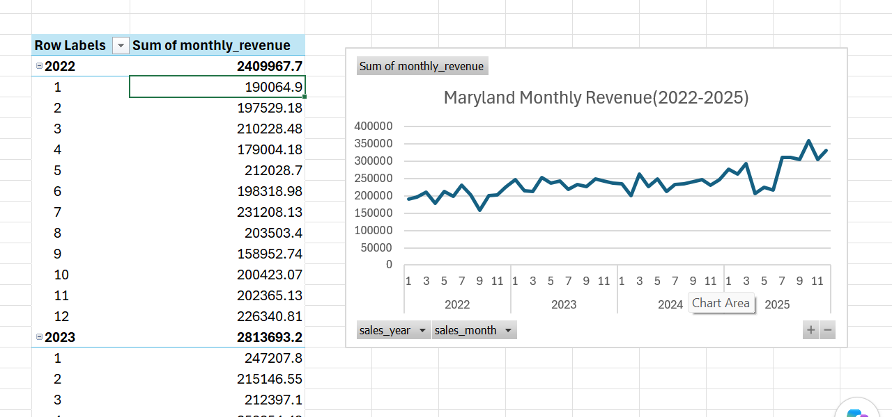

# Capstone 1: Sales Territory Analysis

Data analysis project for EmporiUm, a student bookstore chain.

**Territory analyzed:** Maryland (in-store sales), Northeast region
**Sales Manager:** Shruti Reddy

**Tools:** MySQL Workbench, Excel (PivotCharts), Git/GitHub

## Files
- `Mulugeta_sales_analysis.sql`: SQL queries answering the sales manager's questions
- `mulugeta_territory_chart.xlsx`: PivotChart of Maryland monthly revenue (2022–2025)

## Key Findings
- **Total revenue:** Maryland earned about $11.45M from Jan 2022 to Dec 2025
- **Region comparison:** Maryland is about 47% of Northeast revenue with only 9 of 49 stores (about 18%)
- **Trend:** Revenue grew every year, from about $2.41M (2022) to $3.41M (2025)
- **Categories:** Technology & Accessories has the most transactions and the highest average sale (about $465). Textbook transactions declined each year
- **Stores:** North Harford generates about 76% of Maryland's revenue. Germantown is #2 (about $585K)

## Recommendation
Keep North Harford strong by protecting its technology sales, and look into why its growth slowed (about 8% in 2025).
Put more sales attention on the smaller stores like Germantown, which are growing fast (about 65% combined in 2025),
to reduce the risk of relying on one store.

## Monthly Revenue Chart

## Video
Link coming soon
